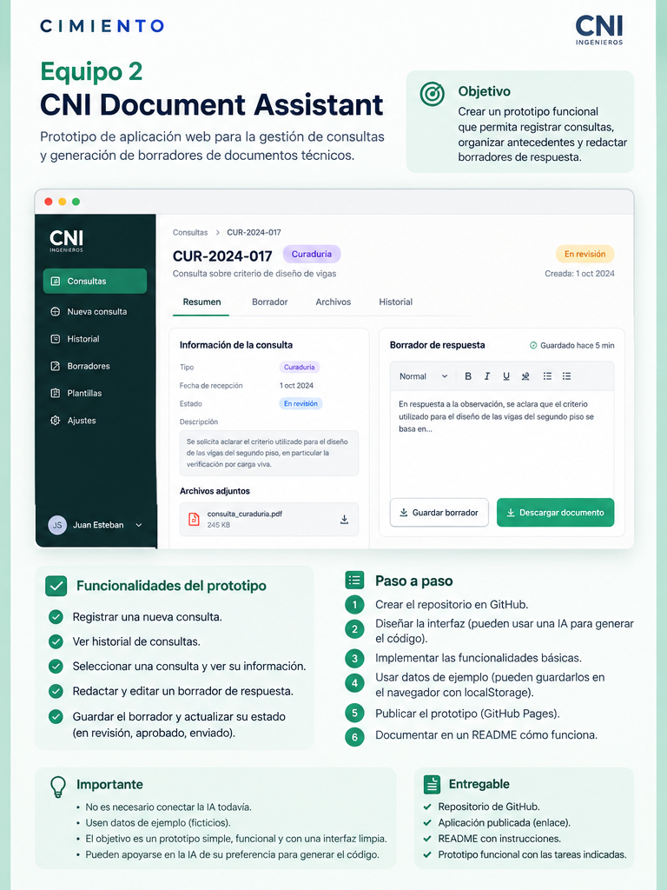

# CNI Document Assistant

**CIMIENTO × CNI Ingenieros** · Primera entrega: **15 de octubre de 2026**

> Gestión de consultas y borradores técnicos. Prototipo académico inicial con datos ficticios.

## Objetivo

Desarrollar una aplicación web sencialla, funcional y visualmente organizada que permita gestionar consultas técnicas provenientes de curadurías y revisores exxternos.

El prototipo facilita el registro de solicitudes, la consulta de su historial, la elaboración de borradores de respuesta y el seguimiento de sus estados.

La imagen incluida es una referencia visual inicial y no representa necesariamente el diseño final implementado.

## Funcionalidades mínimas implementadas

- **Registro de consultas:** permite crear consultas de Curaduría o Revisor Externo, indicando asunto y descripción.
- **Historial de consultas:** presenta las solicitudes registrads, mostrando primero las más recientes.
- **Detalle de consultas:** permite seleccionar una solicitud para visualizar su información.
- **Borradores de respuesta:** permite redactar, editar y guardar una respuesta asociada a cada consulta.
- **Gestión de estados:** permite cambiar el estado de una consulta entre En revisión, Aprobado y Enviado.
- **Actualización automática:** el historial se actualiza cuando se registra una consulta o se guarda un borrador.
- **Panel de estadísticas:** muestra el total de consultas, las que están en revisión y las aprobadas.
- **Persistencia local:** los datos permanecen guardados en el navegador mediante localStorage.

## Tecnologías utilizadas

- **HTML:** estrutura de la aplicación.
- **CSS:** estilos y adaptación a diferentes tamaños de pantalla.
- **JavaScript:** funcionalidades, eventos y actualización de la interfaz.
- **localStorage:** almacenamiento de consultas y borradores en el navegador.
- **CSS:** estilos y adaptación a diferentes tamaños de pantalla.

No se requiere un backend, una base de datos externa ni una API de IA para ejecutar esta versión.

## Ejecución local

1. Clonar o descargar el repositorio.
2. Abrir la carpeta cni-document-assistant-inicio en Visual Studio Code.
3. Abrir el archivo index.html con la extensión Live Server.
4. Utlizar y probar la aplicación desde el navegador.

## Cómo utilizar el prototipo

1. En Nueva consulta, seleccionar Curaduría o Revisor Externo.
2. Ingresar el asunto y la descripción.
3. Presionar Registrar consulta.
4. Seleccionar la consulta desde el historial.
5. Revisar sus datos en la sección de detalles.
6. Escribir o modificar el borrador de respuesta.
7. Seleccionar el estado correspondiente y presionar Guardar borrador.
8. Consultar el panel de estadísticas para visualizar el resumen actualizado.

## Estructura del proyecto

cni-document-assistant-inicio/
├── index.html
├── css/
│   └── styles.css
├── js/
│   ├── app.js
│   ├── storage.js
│   ├── consultas.js
│   ├── historial.js
│   └── borradores.js
├── docs/
│   ├── referencia.png
│   └── instrucciones.pdf
└── README.md

## Decisiones técnicas

**Almacenamiento local:** se utiliza localStorage para conservar la información sin implementar un servidor ni una base de datos.

**Separación de funcionalidades:** el código JavaScript está organizado en módulos según su responsabilidad: almacenamiento, registro, historial, borradores e integración.

**Comunicación entre funcionalidades:** se utilizan eventos personalizados, como consultasActualizadas, para actualizar la interfaz después de modificar los datos.

**Interfaz:** se utilizan HTML y CSS sin frameworks, con una paleta de colores inspirada en la identidad visual de CNI Ingenieros.

**Datos ficticios:** todas las consultas utilizadas para demostrar el funcionamiento son ejemplos académicos.

## Limitaciones

- Los datos se almacenan únicamente en el navegador donde se registran.
- Las consultas no se sincronizan entre usuarios o dispositivos.
- El almacenamiento puede perderse si se eliminan los datos del sitio.
- No hay autenticación de usuarios ni permisos de aprobación.
- El cambio de estado a Aprobado o Enviado es una simulación del flujo de trabajo y no representa una aprobación técnica real.
- El sistema no genera respuestas automáticamente mediante inteligencia artificial.
- No se utilizan documentos confidenciales de CNI Ingenieros.

## Enlace al prototipo

🌐 [Acceder a CNI Document Assistant](https://juanes-gb.github.io/CNI-Document-Assistant/cni-document-assistant-inicio/)

## Estado de la entrega

- [x] Código fuente disponible en GitHub.
- [x] Registro e historial de consultas.
- [x] Consulta de detalles.
- [x] Creación y edición de borradores.
- [x] Gestión de estados.
- [x] Interfaz organizada y adaptable.
- [x] Panel de estadísticas.
- [x] Documentación de ejecución y decisiones técnicas.
- [x] Publicación de un enlace navegable.

## Etapas posteriores (no implementadas en esta entrega)

1. Integrar una API de inteligencia artificial, por ejemplo Gemini o Groq, mediante un backend seguro.
2. Evaluar un modelo local utilizando Ollama.
3. Incorporar documentos autorizados de CNI Ingenieros y, si resulta útil, recuperación de información mediante RAG.

**Importante:** esta primera versión no integra inteligencia artificial, no almacena claves API y no utiliza información confidencial de CNI Ingenieros.
